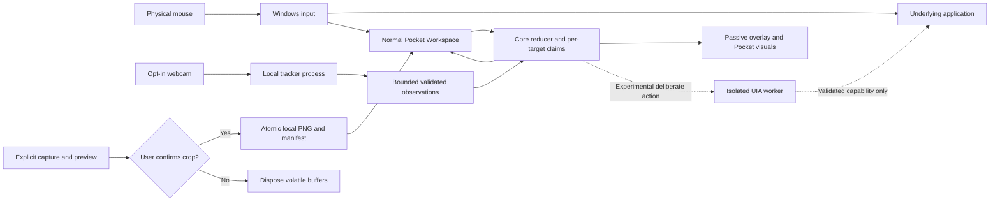
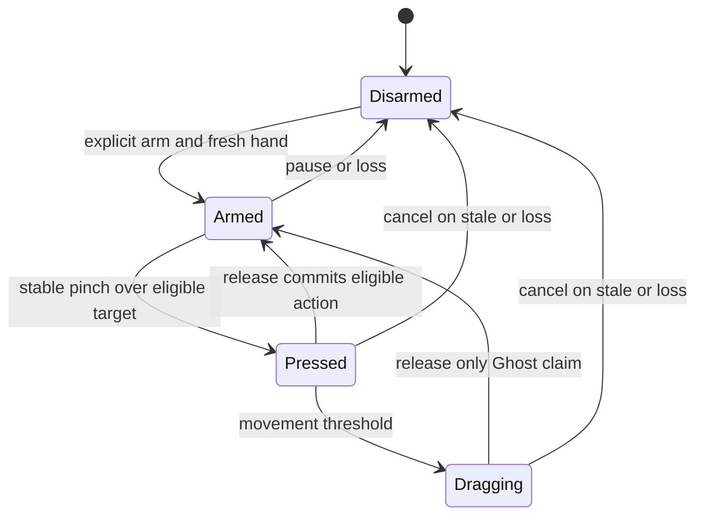
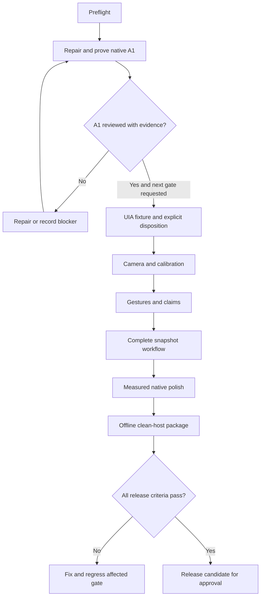

# GHOST — COMPLETE CODEX IMPLEMENTATION DIRECTIVE

Specification date: 2026-11-04. Target: Windows 11 x64. This document is an engineering instruction for future implementation. No feature is certified by its inclusion here. Begin with repair and verification of Gate A1; stop at its review boundary. Later milestones are specified for continuity, and require the next gate instruction before execution.

Execution 08 supplies a narrow next-gate instruction for provisional F06 camera implementation and controlled testing. Section 23 still governs acceptance and release. The instruction requires explicit device opt-in, preserves M02 review, and leaves F07 and later milestones outside scope. [Execution 08 authorization and evidence](../docs/EXECUTION_08_REPORT.md)

## 1. Mission, audience and product identity

Build GHOST as a native, offline Windows reference utility. POCKET is its hidden reference shelf; DUAL is the independent input architecture; GHOST is the hand-controlled logical pointer. Students, hobbyists, shoppers, creators and office users save useful screen excerpts and recall them while working in another application. Promise: “Keep useful things one gesture away without putting down the mouse.” Design principle: “Invisible complexity. Visible precision. Zero compromise.” The broader platform vision does not authorize unrelated AI, cloud, accounts or automation features.

Signature workflow: explicitly capture a region, adjust and preview it, confirm a cropped snapshot, hide the shelf, recall it with a deliberate hand gesture, select/move/resize/pin/scroll the reference while the normal mouse continues working, dismiss it, and restore saved references after restart. Camera-off capture/library/shortcuts/settings are complete product paths. Workspace must allow mouse drag of Card A while GHOST drags Card B, with independent release and cancellation.

## 2. Discovery and source authority

The solution directory is the repository root; verify paths rather than moving or extracting files automatically. Read AGENTS.md, START_HERE.md, CODEX_START_PROMPT.md, VERIFICATION.md, docs/MASTER_SPEC.md, docs/IMPLEMENTATION_RFC.md, docs/research.md, docs/DECISIONS.md, docs/TEST_RESULTS.md, docs/QA_MATRIX.md, docs/COMPATIBILITY_MATRIX.md, docs/DESIGN_SYSTEM.md, design/DESIGN_TOKENS.json, docs/SPECIFICATION_REVIEW.md, and codex/HANDOFF.md. Historical archive/v1 is reference only. Preserve existing assets and failures.

Priority: latest explicit user instruction; binding safety invariants and confirmed product requirements; current tested repository decisions; approved specifications; evidence-compatible code; research; documented assumptions. Resolve contradictions in writing before affected implementation. This directive clarifies the existing contract; numerical defaults introduced below are PROPOSED and must be calibrated, not described as measured.

## 3. Honest implementation baseline

The Windows host reports NT 10.0.26200.0 and x64. `dotnet --info` reports .NET host 8.0.22, Desktop runtimes 8.0.15/8.0.22 and no SDK. Do not infer current patch compliance from installed runtimes. No application binary, native interaction result, camera result, installer result or latency measurement is verified.

Existing source comprises Pocket.App (WPF shell/overlay), Pocket.Core (single-panel interaction), two xUnit test methods, and a handwritten solution. Static defects to reproduce and repair in A1:

1. Projects target net8.0/net8.0-windows despite the approved .NET 10 baseline. Restore net10.0/net10.0-windows; an installed runtime is not an SDK or justification for downgrading.
2. GhostOverlay.cs references Canvas and Border without System.Windows.Controls import. Tests reference Fact/Assert without Xunit import or global using. Treat these as static compile defects until compiler output establishes exact diagnostics.
3. Solution lacks Build.0 mappings and Release project mappings. Regenerate valid SDK project configuration; verify the projects actually build/test rather than accepting a successful no-op solution command.
4. Arrow/Space simulation requires foreground MainWindow; a non-activating overlay cannot receive the expected key events. Add a deterministic internally timed simulation/replay that runs after focus returns to the test editor. No global input injection or keyboard hook.
5. One global Owner cannot model simultaneous independent pointers on different targets. Replace with per-pointer state and per-target claims at the appropriate gate; retain representative A1 ownership tests now.
6. No HWND style readback, Win32 error checks, foreground/cursor sampling, typed physical/DIP conversion, bounds clamp, singleton, tray or explicit overlay cleanup is implemented.
7. Overlay spans the virtual desktop despite the single-display scope. Use one selected primary display for A1. Multi-display interaction remains deferred.

Do not report these source changes as compile or runtime failures observed in this specification session. They are actionable inspection findings. Keep application code unchanged until implementation is requested.

## 4. Requirements registry and release labels

Stable feature IDs below are also requirement IDs; AC-Fxx means that feature's acceptance condition. Evidence classification is independent from delivery state. All F01–F19 are currently unverified. Never infer SHIPPED from a specification heading.

| ID | Classification | Priority / gate | Requirement |
|---|---|---|---|
| F01 | CONFIRMED | P0 / A1 | Single instance, shell, tray, exit, restart |
| F02 | CONFIRMED | P0 / A1 | Layered non-activating passive overlay, mouse pass-through |
| F03 | CONFIRMED | P0 / A1 | Simulated logical GHOST, Pocket hit-test and drag, evidence |
| F04 | CONFIRMED | P0 / B2,C | Independent pointer lifecycles and per-target ownership |
| F05 | CONFIRMED | P1 / A2 | Isolated experimental UIA probe with fixture and watchdog |
| F06 | CONFIRMED | P0 / B1 | Explicit camera enable, local tracker, stop/restart, permission failures |
| F07 | CONFIRMED | P1 / B1 | Calibration, mirror, hand selection, comfort region, sensitivity |
| F08 | CONFIRMED | P0 / B2 | Arm, pinch hysteresis, clutch, stale/lost cancellation |
| F09 | CONFIRMED | P1 / B2,C | Deliberate edge pull and latched Interactive Peek |
| F10 | CONFIRMED | P0 / C | Explicit frozen capture, adjustable region, preview, confirm, cancel |
| F11 | CONFIRMED | P0 / C | Atomic cropped PNG/metadata storage and recovery |
| F12 | CONFIRMED | P1 / C | Shelf/list, select, rename, reorder, delete/undo |
| F13 | CONFIRMED | P1 / C | Pin/unpin, drag, resize, viewer zoom/pan/scroll, source label |
| F14 | CONFIRMED | P0 / C | Conventional Workspace and simultaneous distinct-target drags |
| F15 | CONFIRMED | P0 / C | Full keyboard/mouse path, configurable hotkeys with conflict feedback |
| F16 | CONFIRMED | P1 / C | Onboarding, settings, privacy controls, delete all |
| F17 | CONFIRMED | P1 / D1 | Diagnostics, measured motion/performance, accessibility |
| F18 | CONFIRMED | P0 / D2 | Offline self-contained portable package and install/uninstall guidance |
| F19 | CONFIRMED | P0 / all | Fault recovery, no leaked workers/windows or resurrected interactions |
| P01 | PROPOSED | P2 / after C | Search title/source locally for large libraries |
| P02 | PROPOSED | P2 / after D | Three quick slots, RAM-only pockets, compare view, magnetism profiles |
| I01 | INFERRED | P1 / C | Virtualized list and bounded thumbnail cache as library grows |
| U01 | UNRESOLVED | release | Exact tracker/wheel/model versions, licenses, camera backend compatibility |
| U02 | UNRESOLVED | review | Public branding/installer display name; retain Pocket namespaces |
| U03 | UNRESOLVED | measured | Actual Windows compatibility, gesture comfort and resource footprint |

Delivery states: SHIPPED only after relevant gate evidence; EXPERIMENTAL opt-in with explicit support table; DEFERRED hidden from functional UI; UNSUPPORTED with explanation. External UIA remains EXPERIMENTAL, off by default even if fixture passes. P01/P02 are not required for first release. Notes, editable links, export/import and cloud features are not implied by occasional old examples.

## 5. Invariants and explicit non-goals

Never move or swap the OS cursor for GHOST; never call SetCursorPos, SendInput mouse injection, mouse_event, low-level input hooks, drivers, code injection, UIAccess/elevation bypass, or a privileged service as fallback. Native mouse remains OS-owned. Hand actions use internal target geometry and application commands, never synthetic WPF mouse events. Cancel for one owner cannot affect another owner.

No universal second Windows mouse, arbitrary external drag/drop/typing, passwords/payments/deletion/security dialogs, protected content bypass, gaming/anti-cheat, continuous background screen scraping, raw webcam recording/upload, compulsory paid services/accounts, AI desktop observer, cloud sync, OCR, video player, live crop, browser extension, multi-monitor operation, macOS or Linux in v1. Future extensions need an RFC and separate compatibility tests after D2. Static screenshot, live preview and interactive widget are distinct capabilities.

## 6. Stack and tradeoffs

Use C#, .NET 10 LTS, WPF and documented Win32 on Windows 11 x64. Pin a supported installed SDK in global.json during implementation and record version/hash; restore exact reviewed package versions with lock files. Choose current supported patches from Microsoft rather than freezing this document's lookup date. .NET 10 is the approved baseline; existing .NET 8 code is drift.

WPF retains established HWND/keyboard/accessibility integration. WinUI 3 would add overlay/input uncertainty; use only a measured targeted renderer experiment if WPF fails. Avalonia/Electron/web UI introduce unnecessary platform/runtime scope. Pure C# stays independent of presentation. Python MediaPipe Tasks is the initial isolated local tracker hypothesis; prove exact Windows wheels, native libraries, interpreter and model redistribution before pinning. C++/ONNX alternatives require a measured ADR, working Windows prototype and lawful assets. JSON manifest plus PNG fits a local snapshot library; SQLite adds a migration/dependency cost without a present transactional-query need. Revisit only with measured scale/transaction evidence. No web backend, server state, authentication service or REST API is required.

## 7. Repository/module ownership

Grow incrementally; create a module when its gate needs it:

```text
src/Pocket.App                 lifecycle, tray, accessible settings/workspace
src/Pocket.Core                typed geometry, reducers, gesture FSM, claims
src/Pocket.Overlay             native styles, passive visuals, render transforms
src/Pocket.Capture             explicit one-shot acquisition/crop buffers
src/Pocket.Storage             manifest/assets, serialization, migrations
src/Pocket.Tracker.Contracts   strict tracker DTOs and validators
src/Pocket.Automation.Contracts UIA request/result DTOs
src/Pocket.Automation.Worker   no-window COM MTA worker process
tracker/                      camera/inference, pinned environment, licensed model
tests/Pocket.Core.Tests        deterministic clocks/synthetic observations
tests/Pocket.Storage.Tests     crash consistency, corruption, path validation
tests/Pocket.Automation.TargetApp controlled counters/slider/editor/scroll/hang
tests/Pocket.Desktop.Smoke      window styles and internal replay orchestration
design/                       canonical tokens and visual references
packaging/                    artifact manifest, notices, checksums, clean-host notes
docs/                         canonical specs, research, evidence, diagrams
codex/                        this directive, execution phases, handoff
```

Core has no WPF, Win32, file I/O, camera or COM references. Storage and capture expose asynchronous interfaces; they do not manipulate UI. Worker depends on contracts, not App. App composes services; overlay consumes read-only scene state and emits internal target intents. Share small coordinate/clock types without introducing an omnibus Common dependency. Use one mutation coordinator on the UI dispatcher; I/O and child processes deliver validated immutable events.

## 8. Window topology and coordinate contract

GhostOverlay: one selected display, topmost, AllowsTransparency, no chrome, ShowActivated=false, absent from taskbar/Alt+Tab. Set and read back WS_EX_LAYERED, WS_EX_TRANSPARENT, WS_EX_NOACTIVATE, WS_EX_TOOLWINDOW. Verify P/Invoke return/error semantics, handle lifetime and style reapplication if recreated. Failed configuration hides overlay and surfaces diagnostic error in normal UI. `IsHitTestVisible=false` alone is insufficient. Never switch passive hit testing to intercept mouse when GHOST hovers. Mouse operation belongs to Workspace, capture and settings.

Workspace and Settings are normal focusable accessible windows. CaptureSelection is explicitly foreground. Passive Peek does not activate, show a modal dialog, or forcibly restore focus. A right-edge passive tab is visual; tray/hotkey opens conventional UI for mouse users. Any future clickable tab must be a separate tested input surface and cannot invalidate pass-through over Pocket visuals.

Declare PerMonitorV2 at process startup before any HWND. Types: CameraNormalized (0..1), ScreenPhysicalPx (signed desktop), MonitorLocalPx, WpfDip. Convert selected-monitor position by `localPx=screenPx-monitorOriginPx`, `dip=localPx*96/dpi`; inverse adds origin after scaling. Handle camera mirror exactly once before mapping comfort rectangle. All visual/hit-test coordinates use the same transform snapshot/version. On DPI/display/sleep/session change cancel GHOST, refresh transform, clamp geometry and require safe reacquisition. Test 100/125/150%; 200% when available. Single selected monitor does not permit a virtual-desktop surface or assumptions that origins are always zero.

## 9. Domain state and ownership

Maintain PointerState for Mouse and Ghost independently: position, hover target, pressed target, phase (Idle/Pressed/Dragging), grab offset, sequence and last timestamp. TargetClaim is `targetId -> owner`; each pointer can claim at most one interaction target. Claim acquisition is atomic on dispatcher. Reject a second owner's request for the same target with quiet occupied feedback; allow claims of distinct targets. Deterministic priority for overlapping hit regions: visible z-order, semantic part priority (resize/scroll/action/body), then nearest center; no ambiguous multi-action press.

Press captures the target/offset and interaction kind. Move affects only its claim, clamps bounds, and cannot switch target mid-drag. Release commits that owner's operation. Cancel removes only that owner's claim; retain last safe geometry for pointer move, revert unfinished reorder preview, never invoke a button on cancel. Duplicate Up/Cancel are idempotent. Target deletion cancels all claims on that target without disturbing other targets. Mouse capture loss cancels Mouse only. Tracker/pause/loss cancels Ghost only. No target resurrection on late message or hand reacquisition; advance session epoch on restart. A discrete button invokes only on deliberate press/release within its valid target and fresh state, never hover.

## 10. Tracker protocol and process supervision

Use redirected stdin/stdout JSON Lines for host-owned child processes, no public listening endpoint. Fixed executable path under package root, no shell, no metadata-derived command. Drain stderr concurrently; sanitize and cap logs. Children exit on stdin EOF; use a Windows Job Object or verified equivalent so host crash cannot leave camera/automation processes alive.

Proposed protocol v1 maximum line 16 KiB, strict UTF-8, bounded arrays/text, no NaN/Infinity, one tracker observation latest-slot and ordered health/control stream. Example:

```json
{"v":1,"kind":"observation","session":"uuid","seq":184,"captureMonoMs":482391,"resultMonoMs":482420,"tracked":true,"handedness":"right","landmarks":[[0.52,0.34,0.0]],"quality":{"handednessScore":0.86}}
```

The example array is abbreviated; actual schema requires exactly 21 finite XYZ landmarks when tracked, empty when untracked. Validate x/y against a documented range; reject out-of-image action coordinates rather than silently asserting calibrated confidence. Handedness classification score is not a tracking confidence measure. No pixel payload/frame path crosses IPC. Calibration preview may use a strictly bounded volatile frame channel only if separately reviewed; default implement preview inside tracker-owned calibration UI or an explicitly scoped in-memory transport, with no recording and no general frame stream. Choose the concrete preview route at B1 and test teardown; do not invent it as already implemented.

Tracker commands: Start(cameraId,mirror,hand), Stop, Ping, Shutdown. Responses: Ready, Observation, Health, Error(code,retryable), Stopped. Camera opens only after explicit Start. Camera failure does not disable storage/capture. Proposed heartbeat 1s, worker-unhealthy threshold 3s, graceful shutdown 2s then terminate; gesture stale deadline is separate and much shorter. Bounded restart at 1/2/4s then stop and offer Retry, never restart camera after explicit Off.

MediaPipe LIVE_STREAM permits dropped input. Reducer computes pinch from validated observations before render coalescing; timeout releases even if release frame was dropped. Separate process monotonic clocks have different epochs: handshake with ping/round-trip estimate or host receive age; never subtract unrelated stopwatch values. Distinguish capture-to-result, result-to-host, host-to-render and experimentally measured camera-to-visible latency.

## 11. Gesture and Peek state machines

Camera: Off -> Starting -> Calibrating/ReadyDisarmed -> Tracking -> Stopping -> Off; Starting/Tracking may fail to Unavailable with Retry/Off. Every launch begins camera Off. Pause cancels Ghost and closes camera handles; Resume is explicit and returns ReadyDisarmed. Clutch is a separate short suppression mode that may retain inference with camera indicator; release returns ReadyDisarmed. Define clutch as shortcut/explicit owned target in MVP, with gesture clutch separately validated. ReadyDisarmed still has a visible camera-on indicator; Off and Pause have no open camera.

Ghost: Disarmed -> Armed -> Hover -> Pressed -> Dragging -> Armed. Loss/stale/ambiguity/pause/capture/session change sends Cancel then Disarmed. Reacquisition cannot restore a press. Handedness alone is not a stable identity; track nearest consistent landmarks and disarm on ambiguity. One Euro filtering controls position only, not action resurrection.

PROPOSED initial tuning: normalized pinch distance = thumb-tip/index-tip distance divided by index-MCP/pinky-MCP palm width; reject near-zero palm width. Enter <=0.28, exit >=0.42, 100ms stable press, 80ms stable release, 6 DIP drag threshold; stale sample >150ms cannot begin an action, loss cancels within 250ms from last usable observation. These thresholds require B2 trials in two lighting conditions. Never interpolate/predict a press.

Shelf: Hidden -> EdgeCandidate -> Opening -> InteractivePeek -> Closing -> Hidden. Proposed edge region 32 DIP, dwell 350ms, inward movement >=64 DIP within 900ms, directional cosine >=0.8, cooldown 1200ms. Failed candidate returns Hidden without activation. InteractivePeek latches; it does not require open-palm hold while pinching. Explicit Close/reverse gesture or idle >=12s dismisses; idle clock suspends while a claim is active and resets on deliberate interaction. Pins remain. Reverse gesture must be separately deliberate, not ordinary rightward dragging. Capture cancels Ghost hit testing and suspends Peek. Glance hold-to-show is deferred to avoid mixed instructions.

## 12. Persistent entities and migration

User-local store: `%LOCALAPPDATA%\PocketDualGhost`. No database server or account. OS user profile permissions are the boundary; screenshots are not claimed encrypted. No secret is needed by core app. Root structure: settings.json, manifest.json, manifest.backup.json, assets/<uuid>.png, transaction metadata, and bounded redacted diagnostics. Do not save full-screen images or thumbnail caches to disk by default.

| Entity | Fields and constraints | Lifecycle / ownership |
|---|---|---|
| Manifest | schemaVersion positive integer, generation int64, snapshot list unique UUID, layout list, tombstones | Single serialized writer; reject unknown future schema as read-only; never downgrade destructively |
| Snapshot | id UUID; kind Snapshot; title 1..120 chars trimmed; createdUtc/updatedUtc ISO8601; asset relative UUID path; width/height positive; checksum SHA256; order key; optional processLabel/windowLabel bounded 256; nullable sourceUri | Created only on confirmation; labels are user data, not logs; URI only verified http/https, never inferred from screenshot |
| Layout | snapshotId FK, pinned bool, x/y/width/height DIP finite, monitor key, savedDpi, viewer scale/offset finite | Bounds-clamped on restore; pin is persisted, shelf visibility is transient |
| Settings | schemaVersion, theme system/light/dark, reducedMotion system/on, selectedMonitor, cameraId nullable, mirror, preferredHand, sensitivity bounded, comfortRect, shortcut map, experimentalExternal=false, startupOptIn=false | Save atomic; cameraEnabled is NOT restored as permission to open camera |
| Calibration | cameraId, selected monitor/transform key, hand, mirror, normalized comfortRect, sensitivity, version | Invalidated when mapping changes; calibration landmarks/frames not retained |
| Delete tombstone | snapshotId, removedAtUtc, purgeAfterUtc, metadata needed for Undo | Proposed 10s Undo; durable tombstone means deleted card stays absent after crash |
| Diagnostics | version, timestamp, error codes, bounded timing histograms and anonymous IDs | Proposed 3 files x 1MiB; no raw frames, image content, UIA text or full URLs |

Load manifest into memory keyed by UUID; ordered list by stored order, title/source search only if P01 accepted. Validate unique IDs, referenced assets and finite geometry. Proposed limits: 10,000 metadata entries, 4,096px thumbnail source dimension cap for decoding, 32MiB thumbnail LRU, 128MiB maximum acquisition buffer and 64MiB PNG file input; enforce actual decoded pixel/overflow limits separately. These are tunable engineering defaults; show capacity/error state rather than truncate user records. No indexing service needed.

Save transaction: validate crop/settings -> write and flush crop to same-volume temp -> rename asset final -> write and flush new manifest generation -> atomically replace manifest with backup -> report Saved only after commit. Two files are not a single atomic transaction: a crash after asset rename can leave an orphan; startup recovery reconciles it without deleting plausible valid data. Never publish manifest referencing unfinished asset. On manifest failure retain retryable volatile crop within bounded preview lifetime and report save failure; cleanup only confirmed transaction-owned temp/orphans. Crash consistency is tested at every boundary. Migration copies original manifest, validates transformed data, atomically commits new version; failure opens recovery/read-only without destroying originals. Older binary refuses unsupported schema and offers documented compatible restore.

Delete: commit tombstone/removal from live list before unlink; show Undo 10s and retain asset until deadline. Undo restores original ID/layout/order atomically. Purge tombstones on restart after expiry. Delete all is an explicit normal-window confirmation, cancels writes/claims, removes assets/manifests/backups/tombstones/caches/logs within validated store root, reports individual failures and preserves retry information. Never claim physical secure erasure on SSD or deletion of OS backups/pagefile.

## 13. Internal service and UIA contracts

All async calls take CancellationToken; no disk, COM or image decoding synchronously on dispatcher. Structured errors use code, retryable flag and localized user message; raw exception detail only sanitized diagnostics.

| Interface / operation | Input -> output | Validation / retry / idempotency |
|---|---|---|
| InputCoordinator.Dispatch | epoch, owner, phase, typed point, seq, host monotonic time -> state/effects | Reject stale epoch/sequence; repeated release/cancel no-op; pure reducer tests |
| Capture.AcquireAsync | requestId, selectedMonitor/transform version -> volatile frame/error | One in flight; new invocation focuses existing capture or explains busy; never automatic repeated acquisition |
| Capture.Crop | volatile frame, pixel rectangle -> volatile crop | nonempty bounds, checked dimensions and allocation cap; reject transform change |
| Storage.SaveAsync | operationId UUID, confirmed crop, metadata -> committed snapshot/generation | Same operationId returns prior commit after retry; serialized writes; disk/permission failure leaves no false Saved |
| Storage.Rename/Reorder/Layout | expectedGeneration, bounded edit -> committed generation/conflict | On conflict reload/rebase explicit intent; no silent last writer from stale async completion |
| Storage.Delete/Undo/Purge | operationId, snapshotId or validated all-store intent -> result | Scope validation; tombstones; partial purge failure visible |
| TrackerSupervisor | Start/Stop/Restart settings -> health/events | Explicit enable, sessions, bounded retry; Stop dominates pending start |
| Automation.Probe | requestId, physical point, permitted PID/HWND -> capability/Unsupported | On-demand <=5Hz proposed; one in flight; max reply 16KiB; no invocation on hover |
| Automation.Execute | requestId, capabilityToken, action enum/value, explicit activation -> result | Revalidate identity, bounds, enabled, integrity and pattern immediately; no automatic retry after uncertain side effect |

UIA capability token: opaque worker-local ID, worker epoch, PID, HWND, runtime identity when available, pattern, bounds, expires proposed 300ms. Worker uses COM MTA thread with no windows and releases COM objects in correct apartment. Proposed UX budget 600ms, hard watchdog 2s; terminate/restart hung worker and invalidate tokens. Caller timeout cannot cancel unmanaged COM. Results: Unsupported, Denied, Stale, Timeout, Attempted, Confirmed with verified postcondition. Never infer Confirmed from API return alone. Only tested benign controls in an explicit application/control allowlist; names such as “Delete” are not a sufficient security classifier. Revalidate before action. Permit Invoke/Toggle/Scroll/RangeValue in A2 fixture; optional Selection and ExpandCollapse need extra contracts/tests. No arbitrary URL/process launching from UIA metadata.

## 14. Feature contract conventions

F01–F19 inherit invariants, asynchronous execution, bounded input, truthful errors, keyboard/mouse equivalents, visible focus/disabled/loading states, idempotent repeated activation and context-specific help. No unnecessary permission prompts. “Ready” is replaced by Busy only while a real operation is running; short actions do not require a spinner. No feature is done until its acceptance criterion, linked automated checks where applicable, native observation and evidence entries pass. An error keeps recoverable user work and provides Retry/Cancel where safe. Test IDs Axx/Bxx/Cxx/Dxx refer to docs/QA_MATRIX.md; Sxx below are additional specification tests to add during implementation.

## 15. Feature-by-feature behavior and acceptance

### F01 — Lifecycle (AC-F01; A01,A10,S01)
Precondition ordinary user session. Launch acquires per-user/session mutex; second instance signals existing instance through same-user restricted local mechanism to open normal Workspace, then exits. Tray offers Open, Settings, Pause/Resume when available, Exit; all real handlers. First run opens onboarding; later runs remain tray resident. No camera/data read permission requested unnecessarily. Exit cancels both owners, unregisters hotkeys, stops children, disposes tray/overlay, completes or safely cancels atomic writes. Closing Workspace leaves tray app; Exit ends it. Singleton contention and missing tray fail with usable shell/error, no invisible unrecoverable process. Test rapid double launch, reopen, shutdown while hidden and crash/restart. Done when exactly one host remains, explicit Exit removes all HWNDs/children, and restart restores valid data.

### F02 — Passive overlay (AC-F02; A02,A03,A05,A10,A11)
Enable overlay only after native style readback succeeds. Render GHOST and Pocket visuals without accepting physical mouse or keyboard focus. No screen/camera storage. Hide is immediate on safety error. Use GetCursorPos read-only logging for stationary-mouse trials, GetForegroundWindow, HWND styles, selected-monitor bounds/DPI and underlying click counters. Empty overlay contains only permitted visual tab/GHOST. Done: 100/100 clicks and drag starts reach fixture, 20 reveal/hide typing cycles retain foreground/input, cursor coordinates unchanged for 100 simulated moves, correct Alt+Tab and DPI behavior. Style bits alone cannot pass behavioral tests.

### F03 — Simulator (AC-F03; A04,A05,S02)
Developer-only controller configures finite timed path/press/move/release script using internal input events, with countdown so user can focus editor and begin physical drag. Show explicit “Simulated” state. Keyboard nudges are optional controller convenience; timed replay is the proof path. Stop cancels Ghost only. Validate timestamps, bounds, epochs and script length; no replay of OS input. Panel visibly follows Ghost while mouse works in fixture; action log records ownership and native cursor/focus samples without image capture. Done: deterministic hit/miss, movement offset, cancel and replay tests plus physical concurrent-drag observation.

### F04 — Independent ownership (AC-F04; B05,C09,S03)
Inputs are normalized Mouse/Ghost commands; outputs are separate claims and changed geometry. Initial target miss leaves state idle. Shared-target attempt is rejected; distinct-target drags proceed concurrently. No persistence until layout commits/debounces through writer. Mouse capture loss, Ghost loss, repeated cancel/release, target deletion, z-order collision and owner switch attempts are tested. Done: 30/30 Workspace trials preserve both operations with independent release; property/reducer tests show claims never exceed one owner per target and stale epochs cannot mutate state.

### F05 — Experimental UIA (AC-F05; A06–A09,S04)
Off by default; user deliberately enables and activates a confirmed capability. Probe physical point in fixture and tested app; filter own overlay/process and reject ambiguous underlay. Heuristic window enumeration is optional experiment, not a universal resolver. Unsupported state has quiet indicator; no action. Worker startup/probe busy/stall states are shown in diagnostics. Store only per-app compatibility metadata, not element text. Done: fixture Invoke/Toggle/Scroll/RangeValue verified by counters/state; deliberate hang leaves host responsive; stale target/action rejected; focus and drag outcomes recorded separately. Core may proceed after A2 if external capability is explicitly deferred and hidden.

### F06 — Camera/tracker (AC-F06; B01,B02,B08,B09,B12,S05)
Entry Enable GHOST in onboarding/settings; camera Off is equal route. Starting/Tracking/Paused/Unavailable are visible. Open chosen device only on explicit enable; busy/denied/unplugged/model-missing returns Retry/Use shortcuts and does not break Pocket. Changing device stops old before starting new; Off cancels in-flight start. No raw frames persist. Done: real hardware enable/stop, denial/busy/unplug/process death, EOF/parent crash cleanup and offline tests; handles close, indicator truthful, resume disarmed.

### F07 — Calibration (AC-F07; B03,B07,A11)
Choose camera, mirror, tracked hand and one active display; adjust normalized comfortable region and sensitivity with bounded controls. Show live preview only here after consent, then Move/Pinch/Release practice with actual state feedback. Skip/Cancel leaves shortcuts functional and camera safely paused/off; Repeat available. Persist numeric calibration only. Zero-area region, unknown hand, monitor change and insufficient tracking show actionable validation. Done: synthetic transform round trips and real rectangle-route/practice checks align at tested DPI, ambiguity cancels rather than swapping hands.

### F08 — Gestures (AC-F08; B04–B07,B09,B12,S06)
Only fresh armed observations can press. Pinch uses normalized hysteresis and timed stability; position smoothing never invents actions. Clutch suspends pointer operations, resets offsets, releases Ghost claim, re-arms only explicitly. Handle dropped samples, NaN, sequence reset, two hands, lighting change, camera stop and sleep. Done: >=90% success in 30 deliberate trials in each of two lighting conditions; zero stuck presses in 100 release/loss trials; cancellation deadline observed; no resurrected action after loss.

### F09 — Shelf recall (AC-F09; B10,C10,C11)
Hidden shelf opens through deliberate edge dwell/pull or shortcut/tray to conventional access. No references yields one Capture action routing to explicit capture, plus keyboard/tray instruction. Opening/Closing are interruptible; the same visible geometry is used for hit testing during animation. Peek latches, remains during pinch/drag, explicit Close wins, idle does not interrupt claims. Pins persist after close. Done: pull->pinch->drag->close without hold conflict; <=1 unintended reveal during 20 minutes tuned ordinary motion; camera-off reveal works via normal UI.

### F10 — Capture (AC-F10; C01–C04,S07)
Entry configurable shortcut/tray/Workspace Capture. Camera permission not needed. Cancel Ghost, hide all own overlay/pinned visuals, wait for verified compositor update, acquire selected display pixels once to bounded volatile memory, then show frozen foreground selector. Physical mouse and keyboard can draw/adjust rectangle; preview has Confirm, Back, Cancel/Escape. Translate floor left/top and ceil right/bottom at DPI and clamp to pixel bounds. Empty/oversized selection prevents Confirm. Confirm crops in memory; only selected crop goes to F11, full buffer promptly released. Repeated Confirm is idempotent. On display change abort with retry; black/unavailable images warn “Capture may be blank or unavailable” and require retry/cancel or informed explicit confirmation for legitimate black content. No heuristic can conclusively detect all protected content. No false claim of bypass or success. Done: known pixel fixture verifies exact crop at DPI; cancel at every stage writes no screenshot; save failure stays recoverable; own visuals excluded empirically. Capture is foreground and may interrupt typing/drag; disclose this distinction.

### F11 — Storage/recovery (AC-F11; C05,C06,C12,S08)
Only confirmed crops/settings enter writer. Validate IDs/paths, refuse traversal/absolute paths/reparse escapes; no following untrusted manifest paths outside store. Busy state ends only on commit/error. Decode thumbnails off dispatcher using frozen results. Missing/corrupt item is individually unavailable; valid assets survive. Use backup generation and recovery listing when manifest invalid; do not silently delete orphans. Done: save 10/restart/checksum/reopen; fault injection between file operations; corrupt manifest/PNG/future schema/disk-full/denied-path/duplicate operation tests; old data preserved and retries do not duplicate cards.

### F12 — Library management (AC-F12; C12,C14,S09)
Shelf lists most recently used references with stable user ordering rule: manual order is default; selected current card tracked separately rather than silently reordering during drag. Title rename 1..120 chars with inline validation; Escape cancels. Reorder via drag or keyboard Move up/down; serialize order atomically. Delete moves item into tombstone/Undo window; no deletion on hover or ambiguous swipe. Empty/loading/missing-image states use local feedback and Capture/Retry. Search is P01, not required. Done: all operations persist across restart, repeated click/cancel safe, Undo restores ID/order/layout, purge deadline documented and no Ghost/mouse cross-claim.

### F13 — Reference viewer/pins (AC-F13; C07,C08,C13,C14)
Select opens static Snapshot viewer. Header grip moves panel, corner target resizes, pin toggles persistence, dedicated rail/page controls scroll inside viewer; zoom via +/- and keyboard, pan clamped to content. Proposed zoom 25–400%, minimum panel 240x160 DIP bounded by available work area. Commands are available in normal Workspace for mouse/keyboard; passive panels remain mouse-pass-through. Source label is truthful process/window metadata; Open source only when verified safe URI exists, deliberate foreground action with notice. Hide source action if unavailable. Done: move/resize/pin/scroll survive restart within display bounds, source absence handled, image never represented as live.

### F14 — Workspace (AC-F14; C09,D05,S03)
Conventional window contains library and board/viewer with at least two real cards for concurrency test. Mouse and Ghost route to same reducer with separate IDs; keyboard selection does not overwrite Ghost claim. Tab reaches library/actions/viewer; Escape cancels the relevant active interaction without releasing another owner's claim. Window close cancels scene interactions, leaves tray host. Done: 30/30 two-target sessions, opposite-owner release and target deletion scenarios, foreground/focus behavior as ordinary application documented.

### F15 — Shortcuts/no-camera (AC-F15; C11,C15,D05)
Defaults proposed: Ctrl+Alt+G capture, Ctrl+Alt+P open normal reference window, Ctrl+Alt+Space pause, Ctrl+Alt+W Workspace. RegisterHotKey errors displayed with remap/tray fallback; never override reserved or other application's shortcut. Conventional open is focusable; passive reveal has separate developer/hand path and does not promise keyboard controls in non-activating HWND. Menu accelerators, Tab/Shift+Tab, Enter/Space, arrows, Escape, Delete/Undo and numeric move/resize alternatives cover every gesture operation. Done: complete capture/save/retrieve/pin/resize/manage/delete without camera, with conflicts and screen reader.

### F16 — Onboarding/settings/privacy (AC-F16; B01,C12,C15,D05,S10)
First launch: compact explanation “Your mouse stays yours. Your other hand controls a reference layer.” Equal Use without camera / Enable GHOST routes; skip/repeat practice. Settings tabs General, GHOST, Shortcuts, Privacy, Diagnostics. Only implemented settings visible: theme/reduced motion, selected display, camera/calibration, shortcut map, startup opt-in, data controls. Values validate before Apply; Cancel restores edits. Privacy shows actual store location, camera status, local-processing explanation, deletion controls. Delete-all normal dialog announces scope, irreversible purge and partial failure; confirmation returns focus to origin. Done: settings survive restart without camera auto-start, delete removes app-owned stored data and reports locked files honestly.

### F17 — Design/accessibility/diagnostics (AC-F17; D01–D06,D11)
Apply sections 16–19; developer diagnostics displays actual state, sample age, inference rate, dispatch/render timing, claim owners, drops, CPU/RAM and measured latency categories. No invented confidence/FPS. Diagnostics off by default, bounded samples, explicit export redacted. Done: keyboard/screen-reader/high-contrast/reduced-motion checks on actual native app, measured performance scenarios, approved dummy-content screenshot review and error announcements.

### F18 — Distribution (AC-F18; D07,D08,D10,S11)
Publish win-x64 self-contained portable folder, independently bundle tracker interpreter/wheels/native libraries/model/notices/hashes. No end-user Python/SDK, paid API/account or network dependency. Per-user install is eventual release target; portable folder is first verification artifact. No startup entry without opt-in. Uninstall exits children, removes installation/startup registration; offers keep/delete user data explicitly. Done: clean Windows standard user launches disconnected, full no-camera and real camera path works, exits/uninstalls/reinstalls/rolls back; licenses verified for exact assets and unsigned warnings documented without asking user to disable security.

### F19 — Recovery (AC-F19; A08,B09,D09,S12)
Supervise child processes independently; bounded restart never repeats a non-idempotent external action. Tracker failure cancels Ghost/disarms; UIA failure invalidates tokens and reports uncertain outcome; storage failure preserves last committed state and pending user crop where safe. Lock/sleep/display change cancels claims and suspends camera; resume never opens camera implicitly. UI-level unexpected error closes unsafe overlay, retains conventional recovery path. Done: kill/hang/unplug/focus loss/capture cancel/disk errors/host crash injection leaves no pointer jump, blocker HWND, leaked camera or stuck target.

## 16. Design tokens and components

Canonical design file is design/DESIGN_TOKENS.json. Treat UI sizes as WPF DIPs even where historical token names say Px; raster crop sizes remain physical pixels. Typography: Segoe UI Variable -> Segoe UI. Brand 20 semibold, headings 15 semibold, body 14 normal, metadata 12, minimum actionable 11; approximate line heights 26/21/20/17 DIP. Sentence case; tabular numerals for metrics, no all-caps body text.

Dark tokens: canvas #14191C, surface #202729, raised #283135, border #384347, text #EDEEE8, muted #9DA9A8, accent #96CDB9, accentText #143C31, danger #E09C92. Light: canvas #F4F4F0, surface #FFFFFF, raised #E9ECE9, border #D3DAD7, text #182223, muted #5A6866, accent #327B69, accentText #FFFFFF, danger #B84E46. Warning/success use labeled icon + text; proposed warning #F0C77A dark/#805500 light, success uses accent only after measured contrast. Disabled uses platform disabled text and explicit state, not opacity that makes required text unreadable. High contrast uses system brushes.

Spacing 4/8/12/16/24/32; border 1 DIP; radius small 6, card 11, shelf 14, settings 16. Shelf default 372 DIP, min 296 if work area permits, maximum min(420, work-area width minus 32); use scroll rather than clipping when height exceeds 78% of work area. This resolves the old contradictory 36%-of-monitor width cap on narrow scaled screens. Normal Settings proposed 680x560 DIP, minimum fitting work area with content scrolling; Workspace 960x680 default bounded to work area, library rail 240 only when >=900 available DIP; narrower widths use a single-pane list/view toggle. At small work areas preserve caption/actions and vertical scroll; test 1366x768 physical at 100/125/150%, not just unscaled mockup.

Buttons 36 DIP high, compact mouse target >=32, Ghost hit region 48–56 DIP with deterministic overlap resolution. GHOST ring 18 DIP, 5 DIP center, 1.5 DIP keyline; hover bezel 28; pressed ring 16; lost/paused shape plus label before hiding. Source content dominates card. One muted accent, one modest shadow, no decorative gradients/glows or dashboard statistics.

All component families implement default, hover, visible keyboard focus, pressed/active, disabled and applicable busy/error/success states. Buttons use labeled content and native automation semantics; busy prevents duplicate operation and preserves Cancel if meaningful. Inputs show bounded text and inline errors linked to accessible names. Dropdowns support arrows/type search/Escape. Menus support arrows/Enter/Escape and return focus. Dialogs trap focus, default to safe action, announce purpose, Escape cancels, return focus. Tooltips supplement labels. Toast/Undo is keyboard reachable and announced without stealing focus; errors persist until acted on when transient feedback would be missed. Lists expose selection and item count; missing thumbnails have labeled placeholder. Custom grip/resize/scroll controls expose automation peers and equivalent commands. No permanent spinner for unsupported state.

## 17. Screen and navigation inventory

| Surface | Hierarchy and primary action | State, exit and keyboard behavior |
|---|---|---|
| Onboarding | one-sentence concept, equal camera/no-camera choices, privacy summary | camera off; skip -> ready/tray; Escape safe; normal Tab order |
| Calibration/practice | device/mirror/hand/monitor, preview, comfort area, practice targets | loading/denied/no hand states, Retry/Skip/Off; finish -> paused/disarmed |
| Dormant/tray | minimal optional right-edge visual tab, camera/privacy status | tray Open/Capture/Settings/Exit; no passive mouse trap |
| Interactive Peek | current reference, compact list, pin/close/scroll | empty Capture; loading thumbnail; missing item Retry; Ghost direct hit-test; close preserves pins |
| Pinned reference | snapshot, small title/handle, viewer controls | static label, missing asset message; normal editing via Workspace alternative |
| Capture selection | frozen screen, rect outline, dimensions and instructions | arrows adjust, Shift modifier coarse adjustment; Escape cancels; Next -> preview |
| Capture preview | selected crop, source label, Confirm/Back/Cancel | saving disables repeat Confirm, save error Retry, cancel no files |
| Workspace/library | references list, board/viewer, Capture, Settings | empty prompt, virtualized load, per-item error; Tab/actions/keyboard move/resize |
| Rename/Delete/Undo | focused inline rename or normal confirmation | validation, Escape cancel, Undo restores identity; errors don't silently dismiss |
| Settings | General/GHOST/Shortcuts/Privacy/Diagnostics | Apply/Cancel, validated dirty state, keyboard tabs, no fake option |
| Recovery | concise cause, preserved data status, Retry/Read-only/Close | normal focusable window, accessible error announcement, camera stays off |

No permanent dashboard on launch. Camera settings do not gate library. Capture preview returns to selector on Back with volatile frame; Confirm returns to tray/reference state. Settings invoked from Workspace returns there; tray settings close returns to tray. Open source is a deliberate foreground transition. Unavailable external controls are state feedback, not a new navigation destination.

## 18. Motion

Use exact existing targets: shelf show 260ms, hide 195ms, card enter 160ms, reorder 205ms, hover 115ms, press 80ms. Proposed release 120ms, pin 205ms, dialog/menu 120ms. Cubic ease-out `(0.2,0,0,1)` for entry, ease-in `(0.4,0,1,1)` for exit; shelf 24–32 DIP translation with no overshoot. Card enter 6 DIP; reorder FLIP-style transform. Animations start from current transform on reversal, remain interruptible, and never block semantic commands. WPF transforms/opacity are intended cost controls, not a claim of guaranteed GPU-only composition for layered HWNDs.

Follow real pointer position on display updates with latest filtered sample; no long easing on drag. Hit geometry tracks visible animated positions. Progress only for real work; short errors appear inline, no shaking or flash. OS reduced motion or app preference uses immediate layout and <=80ms optional fade, no springs or reorder travel; loss cancellation is immediate regardless of animation. Measure native pacing before calling it smooth.

## 19. Accessibility and permissions

All conventional screens support keyboard and Windows UIA semantics. Tab order follows hierarchy, focus ring >=2 DIP and visible against adjacent colors, text contrast target >=4.5:1 normal/3:1 large, non-text meaningful boundaries >=3:1; measure actual pairs. Honor system high contrast/text scaling/reduced motion. Use native controls or implement AutomationPeer; announce errors/status without focus theft. Ghost gestures are optional access, never the sole way to retrieve data.

No sign-in, role system, access token or remote authorization needed. OS user identity/profile ACLs provide local boundary. Camera opt-in is app consent followed by Windows privacy availability; do not assume a browser-style permission dialog for every desktop camera backend. Denial opens guidance/shortcuts rather than bypass. Screen capture is explicit foreground command. External controls require explicit opt-in and per-action validation. User-controlled source URL opening is the only planned ordinary action that may launch a networked application; core does not fetch URLs, telemetry or update checks. Startup opt-in independent of camera.

## 20. Security and data boundaries

Treat helper outputs, manifests, images, source labels and UIA providers as untrusted. Check lengths, schema, numbers, canonical paths and decoded pixel sizes; never evaluate commands or open arbitrary URI schemes from metadata. Store root must be validated before delete, migration or asset resolution; reject reparse-point escapes. Same-user IPC reduces exposure but is not an isolation boundary against fully compromised code running as that user. No secrets in repo/logs; no raw UIA element text in diagnostics.

Protect against accidental capture of own surfaces by ordering and observed compositor synchronization; optional WDA_EXCLUDEFROMCAPTURE is supplementary and checked for API failure. It is not DRM/security protection. Black-pixel heuristics cannot distinguish all-black legitimate content from protected content. Save confirmation is explicit and truthful. Release uncropped buffers promptly; do not promise forensic erasure of managed memory, OS paging or backups. Deletion reports exactly the app-owned scope. Dependency lock/hash/SBOM/notices and exact model license review are release requirements; framework Apache license does not establish every model's redistribution permission.

## 21. Performance budgets and measurement

Existing targets: tracking approximately 20–30Hz if hardware supports it; display-paced rendering, p95 frame interval <=20ms on 60Hz test laptop; camera-to-visible median <=120ms/p95 <=220ms. These are targets, not observed results. Proposed additional budgets: camera-off warm usable/tray <=1s and cold <=2s, owned input dispatch p95 <=8ms, thumbnail presentation <=200ms for cached 1,000-card library; camera-off host memory <=150MiB and active combined processes <=500MiB as investigation thresholds. Measure baseline before deciding release thresholds; do not hide misses or weaken a requirement silently.

Record OS build, CPU/GPU, AC/battery, refresh, resolution/DPI, app/package version, scenario duration and method. Benchmark empty overlay, Ghost movement, shelf animation, three images, pinned image, concurrent drag, camera off/on. Distinguish WPF rendering callbacks from displayed frames; end-to-end camera latency needs an observed stimulus/display method or uncertainty disclosure. Compare process-private memory/CPU drift over 30min and 2h; enforce bounded caches/queues first. Optimize measured bottleneck, then remeasure same scenario. Try reduced shadows/decoded image cache/geometry reuse before alternative renderer ADR. Do not sacrifice responsiveness for decorative animation.

## 22. Testing and traceability

Map F01–F19 -> AC-Fxx -> tests above -> implementation gate -> evidence. Keep docs/QA_MATRIX.md IDs unchanged. Additional suites:

| ID | Required verification |
|---|---|
| S01 | mutex/second launch, explicit Exit and crash cleanup |
| S02 | timed internal replay after editor focus; no injected input |
| S03 | two-pointer reducer invariants, different/same target, independent release, deletion, duplicate/out-of-order cancel |
| S04 | invalid/oversized UIA IPC, stale token, wrong PID, unknown app, hung worker, uncertain side effect with no retry |
| S05 | malformed tracker lines, finite landmark count, stale epochs, partial lines, stderr flood, stop while starting |
| S06 | synthetic pinch jitter/loss/clock skew/identity ambiguity; dropped release; no resurrection |
| S07 | crop pixel fixture, allocation overflow, blank content, display change, repeated confirmation/cancel at every phase |
| S08 | traversal/reparse escape, corrupt/missing asset, future schema, disk-full, crash at each commit stage, migration rollback |
| S09 | rename bounds, stable reorder, tombstone crash/undo/purge and locked-delete failure |
| S10 | keyboard/screen reader/contrast/reduced motion, settings save without camera re-enable |
| S11 | clean-host offline package, notices/hashes, user-level install/reinstall/rollback/uninstall |
| S12 | parent/helper death, sleep/lock/resume, no leaked handles/windows, disarmed safe state |

Automated unit tests cover Core and validators with fake clocks; integration tests cover storage/process protocols; native fixture tests cover HWND and observed controls; human trials cover physical mouse continuity, real camera and comfort. Negative tests are mandatory at sensitive boundaries. A fixture event counter is stronger than a visual impression. Do not inject OS mouse input to claim physical-mouse acceptance. Observe real mouse/keyboard actions or record NOT RUN. For external apps record app/version/action, drag retained and focus retained as separate columns. No private screenshots without explicit permission; use approved dummy content for evidence.

## 23. Roadmap and stop boundaries

| Milestone | Dependencies | Exact implementation slice | Completion gate |
|---|---|---|---|
| M00 / preflight | none | verify folder, OS/SDK, source defects, decisions and build graph | tooling reproducible, no camera/capture during audit |
| M01 / A1 | M00 | repair compile/config, .NET10, lifecycle/tray, native overlay/readback, timed Ghost+one panel, coordinate types and evidence fixture | A01–A05,A10; A11 selected setup; core tests; no P0; stop for A1 review |
| M02 / A2 | reviewed A1 | MTA helper/contracts/fixture/timeout and compatibility report | A06–A09; unreliable external path explicitly deferred/disabled |
| M03 / B1 | M02 disposition | local tracker opt-in, validated IPC, calibration, stop/restart | B01–B03,B08–B09; real hardware results and license/version inventory |
| M04 / B2 | B1 | gestures/ownership/edge pull/latched Peek/loss | B04–B12 with measured trials, no stuck input |
| M05 / C | B2 | frozen capture->confirm->atomic save->shelf->viewer/pin->restart, full library/settings/shortcuts, dual Workspace | C01–C15 and no-camera end-to-end; independently released drags |
| M06 / D1 | C | complete native design, accessibility, performance instrument/profile/stress | D01–D06,D11, screenshots approved dummy data, measured budgets |
| M07 / D2 | D1 | bundle exact licensed assets/self-contained runtime, clean host/reinstall/rollback/uninstall | D07–D10 plus all P0 regression, installable user workflow |
| M08 / E | D2 and explicit scope | one separately approved live/video/adapter/multi-display extension | RFC, compatibility and independent test gate |

Within each milestone: inspect -> plan affected files -> implement complete slice -> build/test -> exercise native behavior -> fix -> document evidence -> review. Make conventional controls accessible from their first implementation, refine full motion/performance at D1. Do safe unrelated work inside current gate when blocked; do not skip OS proof and move to webcam. Specification-generation completion does not pass A1. Generic Phase 0–9 numbering does not replace these established gate dependencies.

## 24. Build, test and run commands

Run from verified solution root. Prerequisite: install official supported .NET 10 x64 SDK and restart terminal; this directive does not authorize silent machine-wide installation. Run preflight first. A future implementation must fix solution build mappings before trusting solution commands.

```powershell
powershell -NoProfile -ExecutionPolicy Bypass -File .\scripts\Preflight-Windows.ps1
dotnet --info
dotnet --list-sdks
dotnet restore .\Invey.sln --locked-mode
dotnet build .\Invey.sln -c Debug -p:Platform=x64 --no-restore
dotnet build .\src\Pocket.App\Pocket.App.csproj -c Debug -p:Platform=x64
dotnet test .\tests\Pocket.Core.Tests\Pocket.Core.Tests.csproj -c Debug --logger "trx;LogFileName=core.trx"
dotnet run --project .\src\Pocket.App\Pocket.App.csproj -c Debug -p:Platform=x64
```

Current unmodified scaffold is expected to need repairs; none of these application commands is claimed passed. Confirm test count >0 and actual app output path. Later add Storage/IPC suite commands when projects exist. Keep network restore separate from runtime offline tests; do not use --no-restore until successful matching assets exist. Choose exact approved test dependencies at implementation; existing package versions have not been compatibility/audit validated.

At D2 after configuration is fixed:

```powershell
dotnet publish .\src\Pocket.App\Pocket.App.csproj -c Release -r win-x64 --self-contained true -p:Platform=x64 -p:PublishSingleFile=false -o .\artifacts\pocket-win-x64
```

This only publishes the managed app/runtime. Add tracker/native/model files, manifest, licenses and hashes using verified packaging automation; the command alone does not satisfy offline camera packaging.

## 25. A1 native manual protocol

Build/run with camera disabled. Launch deterministic fixture with button click counter, text editor and drag slider; start timed internal Ghost replay with countdown, then foreground fixture. Use physical mouse: 100 clicks through visible panel/Ghost, stationary cursor during 100 Ghost moves, 20 show/hide typing cycles, 20 continuous external/fixture drag trials while Ghost moves panel. Record cursor and foreground samples, target counters, hold/release continuity, app version, Windows build, resolution, scale and integrity. Inspect Alt+Tab/taskbar and actual style bits. Hide/Exit during replay and verify teardown. Test selected monitor 100/125/150% when available; otherwise record exact untested setups. Stop on any pass-through/focus/cursor P0. Preserve failures. No webcam/UIA in A1. User permission is required before capturing private screen evidence; read-only preflight never captures.

## 26. Diagrams

The following inline diagrams are the minimum self-contained model; canonical focused sources are docs/diagrams/*.mmd. They describe intended implementation, not deployed components.







## 27. Documentation and source continuity

Keep AGENTS concise; point to canonical documents. Append dated research findings with actual source URL/date/confidence, limitation, mitigation, reproduction, measured evidence or NOT RUN, and status; then run scripts/Sync-Research.ps1. Update DECISIONS for architecture changes, TEST_RESULTS for observed outcomes, COMPATIBILITY_MATRIX for app/action-specific behavior, CHANGELOG and codex/HANDOFF for each completed slice. Do not overwrite failed experiments or copy old PASS into new environment. docs/SPECIFICATION_REVIEW.md is the current specification review, not an alternate runtime evidence log.

At session end save current gate, changed files, commands with actual exit codes, unresolved defects, evidence paths and one next actionable task. On resume read those files, inspect scoped status/diffs, validate current state, then continue. Context loss never justifies restarting design or claiming prior verification without artifact. Existing Git walks to an unrelated home-level repository and reports dubious ownership; inspect top-level safely and do not change global Git trust or commit unrelated home files. Work in exact project scope; create/repair repository metadata only with appropriate authority.

## 28. Prevent execution failures

Premature coding: read scope/decisions and list affected gate first. Architecture drift: one reducer/writer and enforced project references. Fake functionality: hide unsupported controls and inspect each handler's actual postcondition. Silent omission: maintain Fxx/AC/test matrix with explicit blocked/deferred rows. Dependency chaos: lock reviewed versions and audit license/native requirements. Overengineering: no module until needed, no server/account layer. Underengineering: boundary validation, cancellation and crash tests required before rollout. Destructive modifications: preserve assets and failed experiments; no broad deletion. Context loss: persisted handoff/decisions/evidence. Testing avoidance: command failure blocks gate; test discovery count checked. Unverified success: record PASS only for executed evidence and specified setup.

## 29. Release, rollback and operations

Produce portable artifact first, then user-local installable distribution with explicit install/uninstall instructions. Release manifest lists build/version/SDK/OS, file hashes, native/model/interpreter versions, notices and known compatibility limits. No telemetry, automatic update service, subscription or runtime download. Optional code signing costs/reputation remain disclosed. Keep last verified package. Installer/versioned directory swap preserves data; migration backup permits rollback only to schema-compatible version. Failed upgrade retains original package and reports repair. Never use old binary on newer schema without read-only refusal/compatible restore. Remove orphan app-owned installation files only after validated paths and user consent when material; never purge snapshots as an uninstall surprise.

## 30. Autonomous execution boundaries

Proceed with authorized reversible edits, inspections, builds and deterministic tests. Choose routine defaults with documented reasoning. Ask only where missing user choice materially changes identity or risk. Do not spend money, publish/deploy externally, contact others, use unauthorized credentials, destroy valuable data or make unrelated identity/security changes. Respect tool sandbox approval requirements. Read-only preflight cannot activate camera or capture desktop. Real camera/screen tests require explicit user activation/permission. A1 stops at its review boundary; later scope does not permit implementing all phases now.

## 31. Definition of done and final verification

For each milestone: code builds with supported SDK; tests discover and pass relevant cases; native behavior observed where required; actual result and environment recorded; no P0 cursor/focus/ownership/privacy/leak defect; errors/recovery and keyboard alternatives work; no decorative fake control; decisions/research/compatibility/changelog/handoff updated. Build success alone never passes OS behavior. Final product: ordinary user installs offline, launches camera off, captures/confirms cropped snapshot, recalls/manages by keyboard and real GHOST, preserves physical mouse in tested concurrent scenarios, restores valid data, recovers from worker/storage failure, deletes data and exits/uninstalls cleanly. Clean-host and exact-asset license gates must pass before release readiness.

## 32. Start instruction

Start M00, re-read current handoff and verify actual environment. Repair only A1 after implementation is authorized. First unblocked tasks: obtain supported .NET 10 SDK through approved mechanism, repair target/import/solution configuration, implement timed simulation and native evidence fixture, then run build/core/native acceptance. Record unavailable human/hardware checks NOT RUN. Stop after A1 review with concrete artifacts and first remaining blocker. Do not start webcam or UIA in A1.
